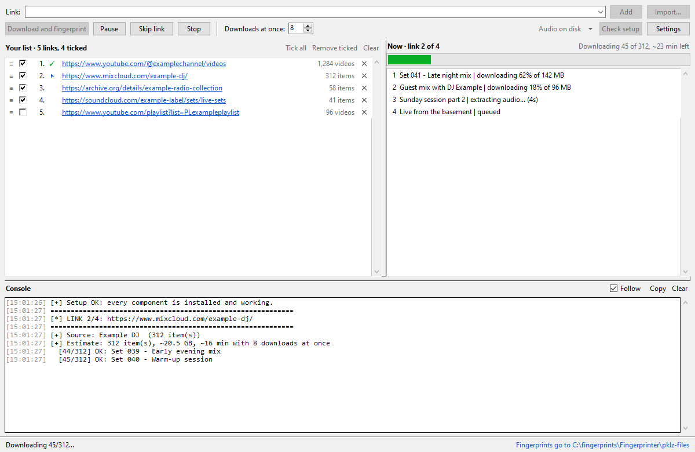
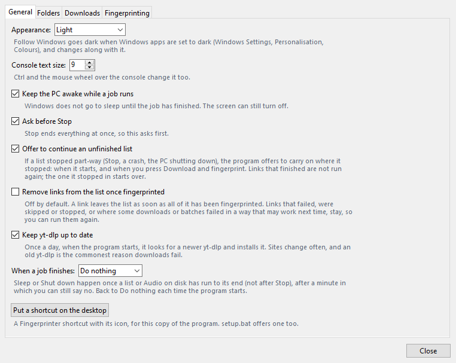
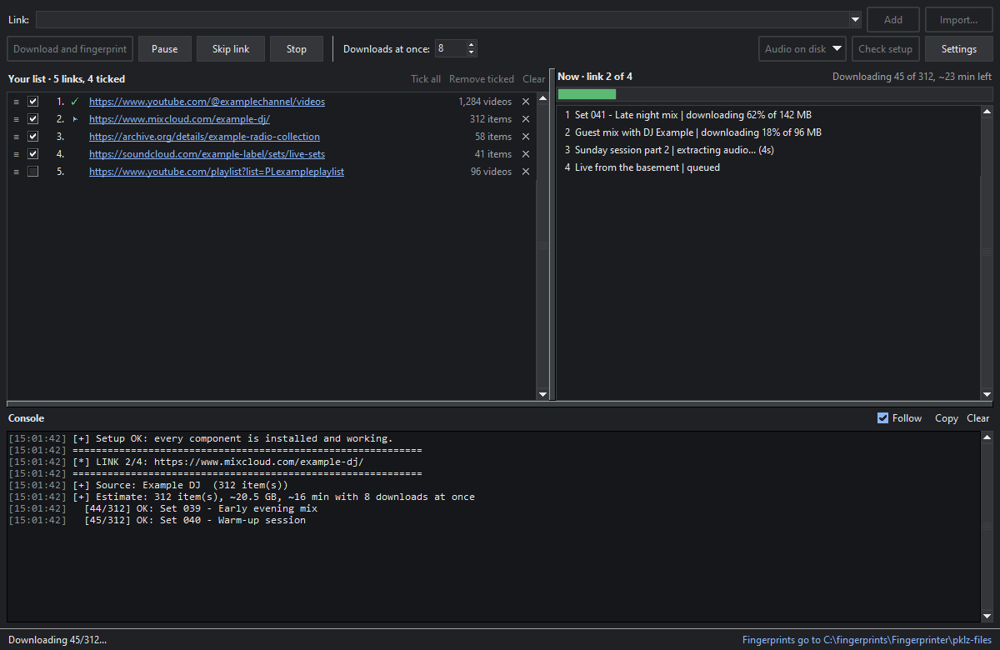

# Fingerprinter

Builds audio fingerprint databases (`.pklz` files) for identifying unknown
songs with [WerZatSong](https://github.com/Nel80s/WerZatSong) and
[WerZatSonGUI](https://github.com/LostwaveItalia/WerZatSonGUI).

Give it links to channels, playlists or single pages on YouTube, Archive.org,
Mixcloud, SoundCloud or [any other site yt-dlp
supports](https://github.com/yt-dlp/yt-dlp/blob/master/supportedsites.md). It
downloads the audio, splits long recordings, and fingerprints everything in
batches with WerZatSong's version of audfprint.

## Requirements

Windows 10 or 11. Everything else is installed by setup.

## Setup

1. Download `Fingerprinter-<version>.zip` from the
   [latest release](https://github.com/EierkuchenHD/fingerprinter/releases/latest)
   and unzip it somewhere permanent. It unpacks into a `Fingerprinter` folder,
   so unzipping to `C:\` gives you `C:\Fingerprinter`. Keep it out of
   `Program Files`: the program saves its settings and files in its own folder.
2. Double-click **`setup.bat`**. It checks for Python, yt-dlp, ffmpeg, Node.js
   and WerZatSong's audfprint, lists anything missing, and installs it once you
   confirm. It also makes a **Fingerprinter** shortcut and asks whether you
   want one on the desktop too.
3. Start the Fingerprinter with that shortcut.

Running `setup.bat` again is safe: anything that already works is left alone.
The program also checks its components each time it starts, and offers to
install anything that has gone missing.

**Updating:** unzip the new version over your existing copy. Your settings,
list and fingerprints are kept, and there is no need to run `setup.bat` again.
The program tells you in its status bar when a new version is out.

It has to be **WerZatSong's audfprint**
([Nel80s/WerZatSong, `libs/audfprint`](https://github.com/Nel80s/WerZatSong/tree/main/libs/audfprint)),
not the original [dpwe/audfprint](https://github.com/dpwe/audfprint), which on
Windows fails on file names with special or non-English characters and rejects
audio files with cover art. Setup installs the right one.

## Using it

1. Paste a link into the **Link** box and press **Add**. You can paste several
   at once, one per line, or use **Import...** for a text file of links. A
   YouTube `@handle` works too.
2. Untick any link you don't want to run this time.
3. Press **Download and fingerprint**.

Finished fingerprints go to `pklz-files\` in the program folder, named after
the channel (for example `@name-1.pklz`). Nothing in that folder is ever
deleted. The status bar at the bottom shows where they go; click it to open
the folder. The downloaded audio is deleted once a link is fingerprinted,
unless you turn on **Keep downloaded audio** in Settings.

The window has three parts:

- **Your list**, on the left: each link with how many videos it has, its
  channel picture, and how its last run ended (**✓** done, **◑** incomplete,
  **!** failed, **»** skipped, **■** stopped). Drag a row by its `≡` handle to
  move it, and right-click a row to copy it, copy the link and its videos,
  count again, move or remove it. **Search** and **Sort** are above the list.
  A row that shows `3 skipped` had videos left out by its last run; click it
  to see which ones and why.
- **Now**, on the right: what is running, with a progress bar and a rough time
  left.
- **Console**, along the bottom: everything that happens, in detail.

Hover over any control to see what it does. A link already in the list is not
added twice, however it is written. The list holds up to 1,000 links.

With a row of the list clicked, these keys work:

| Key | Does |
| --- | --- |
| ↑ ↓ (with Shift: several rows) | Select rows |
| Ctrl+C / Ctrl+V | Copy the selected links / add the links you copied |
| Space | Tick or untick the selected rows |
| Enter | Open the selected links in your browser |
| Delete, Ctrl+Z | Remove the selected rows, put them back |
| Ctrl+↑ Ctrl+↓ | Move the selected rows |
| Ctrl+F | Search the list |

**Pause** freezes everything and **Resume** carries on from the same point.
**Skip link** moves on to the next link, and **Stop** ends the job. If a site
starts refusing downloads (too many requests, or YouTube asking to confirm
you're not a bot), the program pauses by itself and tries again later.

### Continuing an unfinished list

If a list stops part-way (you pressed Stop, the program crashed or Windows
restarted), the program asks the next time whether to continue. Links that had
finished are not run again; the link it stopped in starts over, so nothing ends
up in your fingerprints twice.

### Running a channel again

Turn on **Skip items already fingerprinted in an earlier run** (Settings,
Downloads), and the next run of a channel only downloads what is new. To get
only recent uploads, turn on **Only items published on or after** and enter a
date.

### Audio you already have

The **Audio on disk** menu fingerprints audio files that are already in the
working folder (`downloads\`), without downloading anything: **Split +
fingerprint** splits long files first, **Fingerprint only** uses them as they
are.

### Splitting

Recordings longer than 12 minutes, such as DJ mixes, are split into 6-minute
pieces before fingerprinting, so a match points to a 6-minute part of a long
mix instead of "somewhere in these three hours". The audio is not re-encoded.
Splitting can be turned off in Settings, Fingerprinting.

## Settings

**Settings** has four tabs: General, Folders, Downloads and Fingerprinting.
The defaults suit most jobs, and the window explains each setting. **Downloads
at once**, in the toolbar, sets how many downloads run at the same time;
lower it if many downloads fail with HTTP 429 or 403.

## Uninstalling

Close the Fingerprinter and double-click **`uninstall.bat`** in its folder. It
lists what it will remove and asks first. Your fingerprints, kept audio and
downloads are asked about one by one and kept unless you say otherwise, and
what setup installed outside the folder (Python and its packages) is only
removed if you say yes, as other programs may use it.

## Troubleshooting

Press **Check setup** first. It tests every component, updates yt-dlp, and
offers to install or repair whatever is missing or not working.

| Problem | What to do |
|---|---|
| "WerZatSong's audfprint is needed" | Press **Check setup** to install the right one. |
| `setup.bat` says Python was not found | Install Python from [python.org](https://www.python.org/downloads/windows/) with **Add python.exe to PATH** ticked, then run `setup.bat` again. |
| `setup.bat`: "Organization policies are preventing installation" | That PC (often a work or school one) does not allow the installation. `setup.bat` offers other ways, such as Python from the Microsoft Store. |
| Many downloads fail with HTTP 429 or 403 | The site is limiting you. Lower **Downloads at once**, or try again later. |
| "Cloudflare anti-bot check" (audio.com, for example) | Add `--extractor-args "generic:impersonate"` under **Extra download options** (Settings, Downloads), so yt-dlp impersonates a browser. If the log says yt-dlp cannot impersonate one, press **Check setup** first: it installs curl_cffi, which yt-dlp needs for that. |
| "YouTube asked to confirm you are not a bot" | Choose your browser under **Sign in with cookies from** (Settings, Downloads), lower **Downloads at once**, or wait a while. |
| Private, members-only or age-restricted videos fail | Choose your browser under **Sign in with cookies from** (Settings, Downloads) and close that browser before starting; Firefox works most reliably. |
| "yt-dlp may be out of date" | Press **Check setup** to update it once the job has finished, then run the link again. |
| The downloaded audio is gone | That is expected: it is deleted once a link is fingerprinted. Turn on **Keep downloaded audio** (Settings, Folders) to keep it. |
| A run seems frozen | Big channels take a while to list; **Now** shows how many videos have been found so far. |

## Limitations

- **Windows only.**
- **At most 1,000 links in the list.** For more, run them in batches.
- **Keep nothing of your own in the working folder** (`downloads\`): the
  program deletes the audio there once it is fingerprinted.
- **Size and time estimates are rough.**

## Files and folders

| In the program folder | |
|---|---|
| `pklz-files\` | Your finished fingerprints. |
| `downloads\` | Where audio is downloaded, and deleted again once fingerprinted. |
| `audio\` | Kept downloads, when **Keep downloaded audio** is on. |
| `config.json` | Your settings and your list. |
| `setup.bat`, `uninstall.bat` | Setup and uninstall. |
| `CHANGELOG.md` | What changed in each version. |

Everything else in the folder belongs to the program.

## Credits

Fingerprinting is done by [audfprint](https://github.com/dpwe/audfprint) by Dan
Ellis, in the version maintained with [WerZatSong](https://github.com/Nel80s/WerZatSong)
by Nel, and downloading by [yt-dlp](https://github.com/yt-dlp/yt-dlp). This
project is the window around them.

The icon is based on [Fingerprint](https://www.flaticon.com/free-icon/fingerprint_2313362)
by Pixel perfect from [Flaticon](https://www.flaticon.com/), used under the
Flaticon licence, which requires this credit.

Only download and store material you have the right to. This tool does not
decide that for you.

## License

[MIT](LICENSE). This covers this project only. audfprint, WerZatSong and yt-dlp
are separate projects under their own licences. The icon, `fingerprinter.ico`,
is based on Flaticon artwork and stays under the Flaticon licence (see
[Credits](#credits)), not MIT.
